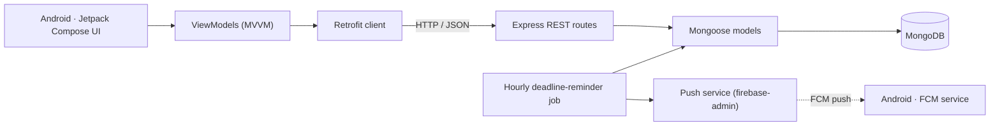

<h1 align="center">StudyCollab</h1>

<p align="center">
  <b>An academic collaboration platform for students and lecturers</b><br/>
  Android app (Kotlin · Jetpack Compose) + REST API (Node.js · Express · MongoDB)
</p>

<p align="center">
  
  
  
  
  
  
  
</p>

---

## Overview

StudyCollab puts course work, group collaboration and lecturer communication in one mobile app. Students follow their courses, submit assignments, work in study groups and book office hours. Lecturers manage materials, create assignments, grade submissions and oversee group work.

## Features

| For students | For lecturers |
|:--|:--|
| Course pages and course materials | Course, syllabus and materials management |
| Assignments with sub-tasks and file submission | Assignment creation and submission tracking |
| Study groups with group chat (auto-refreshing) | Grading with written feedback |
| Office-hours booking | Office-hours slot scheduling |
| Weekly timetable | Study-group oversight and consultation threads |
| Push notifications and deadline reminders | Push notifications |

## Architecture



**Android:** Kotlin, Jetpack Compose (Material 3), MVVM with `ViewModel` and Compose Navigation, Retrofit + Gson, and Firebase Cloud Messaging.
**Backend:** Express 5 with route modules for auth, courses, assignments, submissions, materials, study groups, group work, messages, notifications and office hours. Data is stored in MongoDB through Mongoose, file uploads go through Multer, passwords are hashed with bcrypt, and an hourly job sends deadline reminders that respect each user's notification preferences.

## Testing

- **Unit tests:** `ChatViewModelTest`, `StudyGroupViewModelTest`, `AssignmentViewModelTest` (with a coroutine `MainDispatcherRule`)
- **UI tests:** Compose instrumentation tests (`StudyCollabUITest`) with a custom test runner

## Getting started

### Backend

```bash
cd backend
npm install
# .env  →  MONGODB_URI=<your MongoDB connection string>   PORT=3000
# place your Firebase service-account key at backend/firebase-service-account.json (git-ignored)
node setup_db.js            # optional: seed demo data (see also seed_full_university.js)
npm run dev                 # starts the API on http://localhost:3000
```

### Android app

1. Open `studycollab-app/` in Android Studio.
2. Add your `google-services.json` to `app/`. It is git-ignored.
3. Set `BASE_URL` in `utils/Constants.kt`. Use `http://10.0.2.2:3000/` for the emulator, or your machine's LAN IP for a physical device.
4. Run on an emulator or device (API 24+).

## Team

Built by a team of three: [@Eladi24](https://github.com/Eladi24), [@adirofir123](https://github.com/adirofir123) and [@GalAshkenazi20](https://github.com/GalAshkenazi20).

My contributions (Gal): study groups and chat, the timetable, push notifications, and university data seeding for the database.
